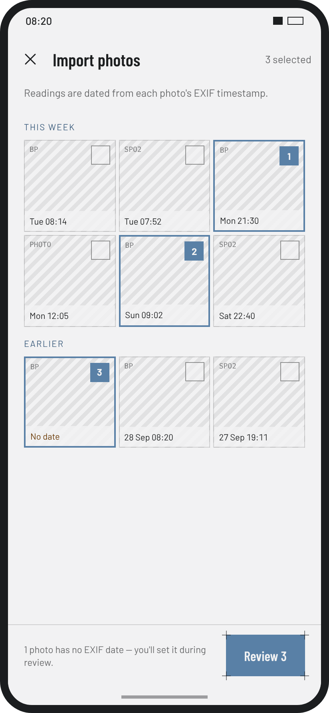

## BPMO

BPMO is a blood pressure and oxygen monitoring android app.

On the device the app is called **Vitals**. You photograph your blood pressure monitor or pulse oximeter, or import photos you've already taken, and it reads the numbers off the display. Each reading is dated from the photo, and you check it on a Review screen before it's saved. From your saved readings you get 7-day and 30-day averages, a day-by-day history and weekly or monthly trend charts. Everything stays on the phone.

It's built in Kotlin with Jetpack Compose and Material 3, following the design handoff in [`design/`](design/README.md).

<p align="center">
  
  
</p>

> The screenshots are rendered from the HTML design mockups in [`design/`](design/), which the app is built to match. They show the mockups' sample data (the week of 14–20 Oct 2026), and photos appear as hatched placeholders.

### Screens

**Today** shows your average blood pressure for the last 7 or 30 days, with its category (Normal, Elevated, Stage 1, Stage 2 or Crisis, following the AHA guidelines for adults). Tiles for heart rate and SpO₂ have small trend lines, and your three latest readings sit underneath. Scan reading and Import are the two buttons at the bottom right.

**History** lists every reading grouped by day. You can filter to blood pressure or SpO₂ only, or search your notes. Tap a reading to see the source photo, how it was dated and anything you corrected. You can edit or delete it from there.

**Trends** shows a week or a month at a time. Blood pressure appears as floating bars from diastolic up to systolic, coloured by category, with the 130/80 thresholds marked. Below are the heart-rate and SpO₂ lines, a count of readings per category and a table of averages, minimums and maximums. The download button exports a CSV of all your readings, or a PDF summary of the period on screen.

| | Today | History | Trends |
|---|:---:|:---:|:---:|
| **Light** |  |  |  |
| **Dark** |  |  |  |

### Adding a reading

**Scan** opens the camera, which always uses a dark screen. Choose BP monitor or Oximeter and fit the display inside the frame. Once the display is found, the values show up live, and auto-capture takes the photo when they've held steady for about a second.

**Import** opens the Android Photo Picker for one or more past photos. They appear in a grid with the time each was taken, read from the photo's EXIF data. A photo with no date is flagged, and you set its date during review.

**Review** shows every reading before it's saved. Boxes on the photo mark where each value was read. Any value the app wasn't sure of gets an orange border and a "check" note, and values outside a plausible range block saving. The category updates as you edit. You can change the date and time, and add a note, with quick chips such as "Before meds" or "Left arm". A reading in the hypertensive-crisis range shows advice on what to do before it's saved.

<table>
  <tr>
    <th>Scan (always dark)</th>
    <th>Import</th>
    <th>Review, light</th>
    <th>Review, dark</th>
  </tr>
  <tr>
    <td></td>
    <td></td>
    <td></td>
    <td></td>
  </tr>
</table>

### Privacy and lock

Readings and photos are kept in app-private storage and excluded from cloud backup. In Settings you can require your fingerprint, face or device PIN to open the app. The lock asks again after the app has been in the background for a time you choose: immediately, 1 minute or 5 minutes. After three failed biometric attempts it falls back to your PIN, and app content is hidden from screenshots and the recents screen while the app is locked. Settings also has an option to turn the category colours off.

| | Reading detail | Lock |
|---|:---:|:---:|
| **Light** |  |  |
| **Dark** |  |  |

### Phones, foldables and tablets

On phones, navigation is a bar along the bottom. On wider screens, such as an unfolded foldable, it moves to a rail on the left that also holds the Scan button. History then shows the list and the selected reading side by side. On tablets, Trends sits beside the Today screen (see the top of this page).

<p align="center">
  
</p>

### Build

You need JDK 17 or newer and the Android SDK (platform 35).

```sh
./gradlew assembleDebug        # app/build/outputs/apk/debug/app-debug.apk
./gradlew :core:test           # domain logic: categories, validation, averages, OCR parsing, EXIF dates
./gradlew :app:testDebugUnitTest
```

On every push, GitHub Actions (`.github/workflows/android.yml`) runs the tests, builds the debug APK and runs lint. You can download the APK from each run's `vitals-debug` artifact.

### Layout

- `core/`: plain Kotlin with no Android dependencies, holding the AHA category rules, validation, averages, trend periods, the display parser, EXIF date parsing, Review form state and CSV export. It's unit-tested on the JVM.
- `app/`: the Android app.
  - `data/`: Room and DataStore.
  - `extraction/`: ML Kit and EXIF.
  - `security/`: the app lock.
  - `export/`: CSV and PDF.
  - `ui/`: one package per screen.
- `design/`: the design handoff and the HTML mockups.
- `docs/screenshots/`: the images in this README.

### Credits

Barlow and Barlow Condensed are under the SIL Open Font License, and the icons are Lucide under ISC. The licence texts are in `app/licenses/`.
